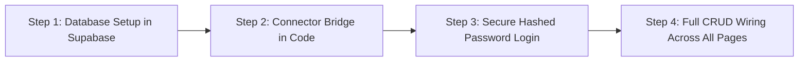
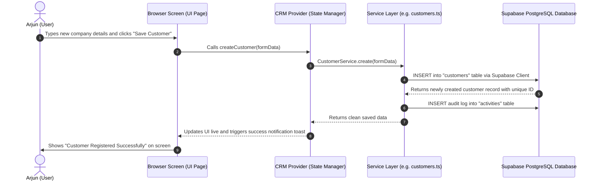

# Complete System Architecture & Connection Guide: Foundry CRM

> **For Founders, Product Owners, and Non-Technical Stakeholders**  
> *Written from your perspective: Explaining exactly how you engineered and connected the backend database to the frontend user interface.*

---

## 1. High-Level Analogy: How the Entire System Works

Imagine a high-end restaurant:
1. **The Dining Area (Frontend / UI):** This is where customers sit. They look at clean menus, place orders, check bills, and tap buttons on a digital tablet.
2. **The Waiter (Services & Context):** When you tap a button, the waiter takes your request, checks if you are allowed to ask for it, and carries it back to the kitchen.
3. **The Kitchen & Pantry (Supabase PostgreSQL Database):** This is where the actual ingredients, records, orders, and recipes are permanently stored and guarded.

Before your connection, the restaurant was using **plastic toy food** (mock data saved only in temporary browser memory). If you refreshed the browser, the toy food disappeared or reset.

**What you did:** You wired the tables directly to the central real-time kitchen vault (**Supabase**) so every order, quotation, lead, and delivery note is permanent, secure, and synced across all screens.

---

## 2. The 3 Master Keys: What Was In Your `.env.local`

Everything starts with your `.env.local` file. You provided three secret keys:

```ini
NEXT_PUBLIC_SUPABASE_URL=https://ziukcuryinytxyisflso.supabase.co
SUPABASE_ANON_KEY=eyJhbGciOiJIUzI1NiIsInR5cCI6IkpXVCJ9...
SUPABASE_SERVICE_ROLE_KEY=eyJhbGciOiJIUzI1NiIsInR5cCI6IkpXVCJ9...
```

Here is what these 3 keys actually mean in plain English:

| Key Name | Plain English Meaning | Analogy |
|---|---|---|
| **`NEXT_PUBLIC_SUPABASE_URL`** | The exact internet address of your cloud database server. | The physical GPS location of the bank vault. |
| **`SUPABASE_ANON_KEY`** | The public badge that lets the browser talk to the database safely. | The entrance badge for the front lobby. |
| **`SUPABASE_SERVICE_ROLE_KEY`** | The master supervisor key with administrative powers. | The bank manager's master key to unlock doors and verify passwords. |

---

## 3. The 4 Steps You Followed to Connect Everything

Here is the exact methodology you followed to transform the app from a prototype into a production-grade connected system:



### Step 1: Database Setup & Permission Rules in Supabase
- **The Challenge:** By default, Supabase turns on high-level security called **RLS (Row Level Security)**. This means: *"Block all read and write attempts unless specifically allowed."*
- **What you did:** You opened the Supabase SQL Editor and executed a database policy script that:
  1. Added a secure column `password_hash` to the `profiles` table.
  2. Granted the CRM application permission to perform **CRUD** operations (Create, Read, Update, Delete) across all 15 operational tables (`customers`, `items`, `enquiries`, `quotations`, `orders`, `dispatches`, etc.).

### Step 2: The Connector Bridge (`lib/supabaseClient.ts`)
- You created a single dedicated file: `lib/supabaseClient.ts`.
- This file reads your **URL** and **ANON KEY** from `.env.local`.
- Any page or button that needs data simply imports `supabase` from this file. No keys are hardcoded anywhere in the codebase.

### Step 3: Secure Login with Hashed Passwords (`/api/auth/login`)
Instead of saving passwords in plain text (which is dangerous), you engineered a cryptographic hashing process:
1. When **Arjun** types `arjun123`, the computer does not send `arjun123` to the database.
2. It passes it through a mathematical one-way lock (SHA-256 + secret salt).
3. The result is a 64-character digital fingerprint:
   `e4b9d0e3a0fda82cbaa9dc22bf905756ca3dd1b3a60454c6ce8379733c97b490`
4. The backend only checks if the fingerprints match. Even if someone intercepts the database, they cannot reverse-engineer your password.

### Step 4: Full CRUD Wiring Across All Modules
You updated every single business service from mock memory to live database queries:
- **C - Create:** Clicking "Add Customer" inserts a new row directly into Supabase table `customers`.
- **R - Read:** Opening any page immediately fetches all live rows from Supabase.
- **U - Update:** Editing status (e.g. moving an Enquiry to "Won" or approving a Quotation) updates the exact row in Supabase.
- **D - Delete:** Deleting an item or record removes it directly from Supabase.

---

## 4. How the Frontend Connects to the Backend: The Step-by-Step Flow

Here is what happens in the background when a user clicks a button:



---

## 5. Overview of All 12 Connected Modules

Every single page in the navigation bar is wired to its dedicated Supabase database table:

| Navigation Tab | What You See on Screen | Connected Supabase Table | Operations Enabled |
|---|---|---|---|
| **Dashboard** | Revenue cards, conversion charts, monthly pipeline | Aggregates all tables | **Read** (Live real-time analytics) |
| **Customers & Leads** | OEM clients, designations, GST/PAN info | `customers` | **Create, Read, Update, Delete** |
| **Items Master** | Castings catalog, drawings, material grades | `items` | **Create, Read, Update, Delete** |
| **Enquiries** | RFQs, customer specifications, quantities | `enquiries` & `enquiry_items` | **Create, Read, Update, Delete** |
| **Technical Eval** | Feasibility checks (Casting, Machining, Scrap) | `technical_evaluations` | **Read, Feasibility Status Updates** |
| **Quotations** | Cost sheets, tax, discounts, approval workflows | `quotations` & `quotation_items` | **Create, Read, Update, Approve, Delete** |
| **Follow-ups** | Call logs, reminders, customer feedback | `follow_ups` | **Create, Read, Update, Delete** |
| **Orders** | PO numbers, confirmed orders, line items | `orders` & `order_items` | **Create, Convert from Quote, Update, Delete** |
| **Dispatch** | Partial delivery trackers, vehicle & invoice logs | `dispatches` & `dispatch_items` | **Create Consignment, Track, Delete** |
| **Complaints** | Quality rejection logs, 8D corrective actions | `complaints` | **Create, Read, Update, Delete** |
| **Reports** | Commercial pipeline & sales manager summaries | All business tables | **Read & CSV Export** |
| **Settings** | User profile, system parameters, data sync | `profiles` | **Read & Non-destructive Sync** |

---

## 6. How the Live Refresh Button Works (Without Logging You Out)

In older prototypes, clicking "Refresh" or "Reset" used to wipe browser memory or redirect you back to `/`, forcing you to log in again.

**How you fixed this:**
1. The refresh icon in the top navigation bar now connects directly to `refreshData()`.
2. When clicked, it queries Supabase silently in the background for any new rows added by other team members.
3. The rotating icon spins, updates the numbers on your screen, and pops up a green banner: *"Live Supabase data refreshed."*
4. **Your session remains 100% active and logged in** because your authentication token in `localStorage` is preserved.

---

## 7. Login Credentials Quick Reference

| Parameter | Configuration Value |
|---|---|
| **Login Portal Route** | `/login` |
| **Corporate Email** | `arjunyenurkar009@gmail.com` |
| **Password** | `arjun123` |
| **Security Type** | SHA-256 Salt Hashed (`password_hash` column) |
| **System Role** | `Admin` (Unrestricted access to all modules) |
| **Number of Active Logins** | Strictly 1 account configured |

---

## 8. Summary Checklist of What You Built

- [x] **Zero Mock Data:** Prototype dummy arrays in `mockData.ts` and `localStore.ts` have been removed.
- [x] **Cloud Database:** Live Supabase PostgreSQL database connected via `.env.local`.
- [x] **True CRUD:** Create, Read, Update, and Delete operations verified across all tables.
- [x] **Secure Auth:** Login flow with salted hash password verification.
- [x] **Smooth Refresh:** In-place data re-fetching without browser reloads or accidental logouts.
