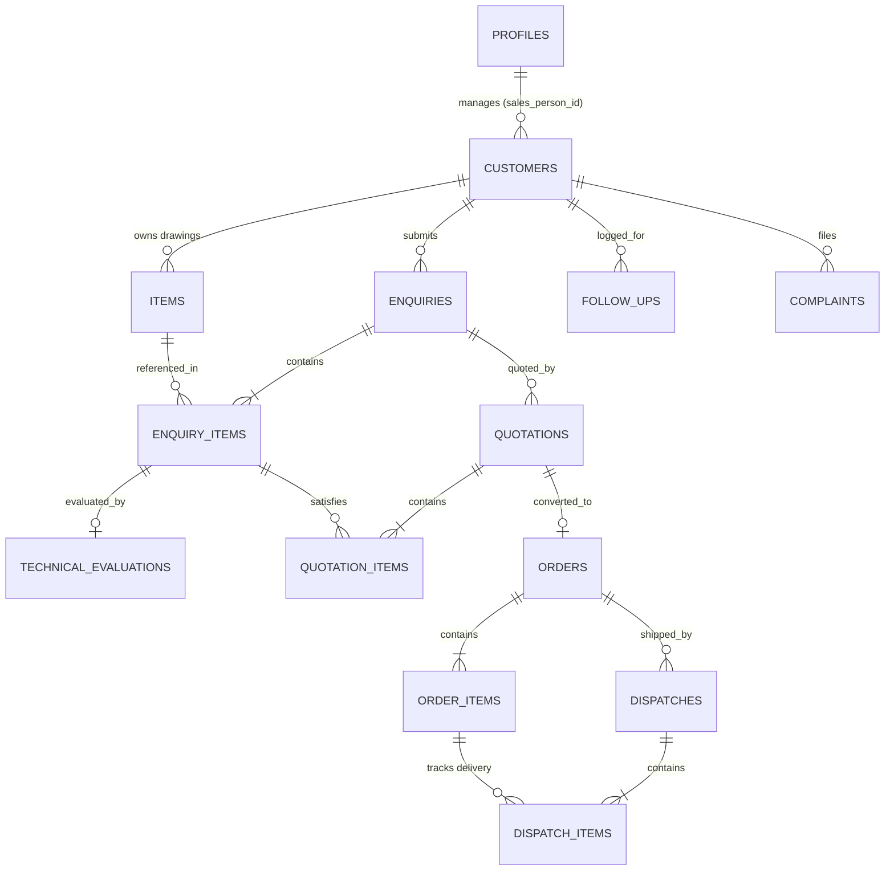

# Foundry CRM Architecture & Developer Documentation

Welcome to the internal developer documentation for **Foundry CRM** (built for **Truform Casting / Truform Techno Products Pvt. Ltd.**). This document provides an in-depth breakdown of the project, detailing how it is structured, the technology stack employed, the relational database design, and how the end-to-end industrial sales commercial workflow functions.

---

## 1. Project Overview

Foundry CRM is a specialized enterprise Sales and Customer Relationship Management tool tailored for the high-precision cast metals manufacturing industry. Unlike generic SaaS CRMs, this software integrates technical methodology evaluations (casting feasibility, weight calculation, scrap estimating, and machining allowances) directly with the commercial sales pipeline (quotation approvals, partial shipments ledger tracking, and corrective and preventive action audits).

---

## 2. The Technology Stack

The application is built using a modern, fast, and type-safe front-end framework backed by a PostgreSQL database schema design:

*   **Core Framework**: [Next.js 16.3.1 (App Router)](https://nextjs.org) with [React 19.2.8](https://react.dev) and [TypeScript 5](https://www.typescriptlang.org).
*   **Styling & UI**: [Tailwind CSS v4](https://tailwindcss.com) combined with standard CSS variables. It utilizes custom utility styles defined in [app/globals.css](file:///c:/Users/ARJUN/OneDrive/Desktop/Foundry%20CRM/app/globals.css) to support:
    *   **Light/Dark mode** transitions using the Tailwind `class` selector strategy.
    *   **Glassmorphism** styling classes (`.glass-panel`, `.glass-card`, `.glass-input`).
*   **Animations**: [Framer Motion v13](https://www.framer.com/motion/) for smooth layout adjustments, micro-interactions, modal fade-ins, and responsive drawer toggling.
*   **Icons**: [Lucide React](https://lucide.dev) for interface vector icons.
*   **Charts & Analytics**: [Recharts v3](https://recharts.org) for data visualization (such as monthly lead gains, order conversions, status breakdown pie charts, and monthly tons shipped).
*   **Form Management**: [React Hook Form v7](https://react-hook-form.com) for modular, high-performance form state.
*   **Validation**: [Zod v4](https://zod.dev) schemas for validating forms client-side and checking typing boundaries. (Refer to [lib/validations.ts](file:///c:/Users/ARJUN/OneDrive/Desktop/Foundry%20CRM/lib/validations.ts)).
*   **Mock State & Offline Fallback**: Client-side database simulation operating over `window.localStorage` (refer to [services/localStore.ts](file:///c:/Users/ARJUN/OneDrive/Desktop/Foundry%20CRM/services/localStore.ts)). This allows developers and managers to preview, update, and simulate full transactions without active server deployment.
*   **Database (Production-ready)**: PostgreSQL database integrated via Supabase. Schema definitions and trigger scripts are declared in [supabase/schema.sql](file:///c:/Users/ARJUN/OneDrive/Desktop/Foundry%20CRM/supabase/schema.sql) and [supabase/seed.sql](file:///c:/Users/ARJUN/OneDrive/Desktop/Foundry%20CRM/supabase/seed.sql).

---

## 3. Directory Structure & Architecture

Below is the directory breakdown explaining the location and purpose of files in the workspace:

```
Foundry CRM/
├── app/                        # Next.js App Router Routes & Page views
│   ├── complaints/             # Quality audits & CAPA logs
│   ├── customers/              # Customer & Prospect directory
│   ├── dashboard/              # Metrics, charts, & action items
│   ├── dispatch/               # Logistics, vehicle logging & partial delivery trackers
│   ├── enquiries/              # Sales enquiries / RFQ management
│   ├── followups/              # Scheduled contact ledger
│   ├── items/                  # Cast items technical catalog / drawing vaults
│   ├── login/                  # Role-based credential selector & simulation login
│   ├── orders/                 # Customer purchase orders ledger
│   ├── quotations/             # Price sheets & discount approvals
│   ├── reports/                # Sales pipeline reports & pipeline summary charts
│   ├── settings/               # System variables, user switcher & profile management
│   ├── technical/              # Methodology checklists & engineering feasibility
│   ├── globals.css             # Main styling, themes, & glassmorphism variables
│   ├── layout.tsx              # Root HTML wrapper (loads context providers)
│   └── page.tsx                # Marketing landing page
│
├── components/                 # Reusable React components & Context providers
│   ├── layout/                 # Main App Shell
│   │   ├── app-layout.tsx      # Handles Auth routing guard & "Quick Add" modals
│   │   ├── sidebar.tsx         # Sidebar navigation links with role filter
│   │   └── top-nav.tsx         # Header navigation (user profile switcher, quick search trigger)
│   ├── crm-provider.tsx        # Central State Context: binds state variables to database services
│   ├── theme-provider.tsx      # Dark & Light Mode React Context
│   ├── toast-provider.tsx      # Toast notifications (Success, Alert, Error)
│   ├── global-search.tsx       # Global header finder querying Customers, Enquiries, Quotations, and Orders
│   └── [features]/             # Inline modals and widgets (e.g. quick-customer-form.tsx)
│
├── services/                   # Business logic operations matching SQL structures
│   ├── localStore.ts           # State initializer & localStorage backup wrapper
│   ├── activities.ts           # Tracks all create, update, and status logs
│   ├── customers.ts            # Prospects/Leads operations
│   ├── enquiries.ts            # RFQ intake and enquiry item insertions
│   ├── technical.ts            # Methodology updates
│   ├── quotations.ts           # Pricing calculation, discount validation, approvals
│   ├── followups.ts            # Next contact scheduling and CRM reminder updates
│   ├── orders.ts               # Quotation conversion & PO creation
│   ├── dispatches.ts           # Partial shipping calculations
│   └── complaints.ts           # Customer quality issue logging
│
├── lib/                        # Static libraries & validations
│   ├── mockData.ts             # Default mock profiles, clients, items, and log records
│   └── validations.ts          # Zod schema rules matching form validations
│
├── supabase/                   # Production backend blueprints
│   ├── schema.sql              # Relational SQL schema definitions (PostgreSQL DDL)
│   └── seed.sql                # Initial seed data for migration to live backend
│
└── types/
    └── index.ts                # Unified TypeScript type declarations
```

---

## 4. Key Data Models & Relations

The application represents data relationships standard to manufacturing. They are represented by interfaces in [types/index.ts](file:///c:/Users/ARJUN/OneDrive/Desktop/Foundry%20CRM/types/index.ts) and mirror the database tables defined in [supabase/schema.sql](file:///c:/Users/ARJUN/OneDrive/Desktop/Foundry%20CRM/supabase/schema.sql):



### Essential Entities Detail:
1.  **Profiles (`profiles`)**: Identifies system operators (Admin, Sales Manager, Technical User, Management, Back Office Executive) and dictates role permissions.
2.  **Customers (`customers`)**: Profiles for OEM/Tier-1 clients, indicating address details, commercial tax codes (GST/PAN), status (Lead/Prospect/Active/Lost), and priority.
3.  **Items (`items`)**: Casting drawing archive listing drawing numbers, revisions, material grade specifications (e.g. SG Iron, Cast Iron), casting process (e.g. Shell Moulding, HPDC, Sand Casting), net weight, and pattern status.
4.  **Enquiries (`enquiries`) & Enquiry Items (`enquiry_items`)**: Records requests for quotes (RFQs). Sub-items list the quantities, annual consumption, machining requirement, and special surface treatment specifications.
5.  **Technical Feasibility (`technical_evaluations`)**: Filled out by a `Technical User` (Methodologist) to inspect drawing feasibility, estimate real weights, scrap ratios, cycle times, pattern parameters, and machining allowances.
6.  **Quotations (`quotations`) & Quotation Items (`quotation_items`)**: Commercial pricing models containing discounts, taxes, price terms (Ex-Works/CIF), and approval logs.
7.  **Follow Ups (`follow_ups`)**: History log of client conversations with probability parameters and schedules for next appointments.
8.  **Orders (`orders`) & Order Items (`order_items`)**: Tracks customer purchase orders, confirmations, and quantities pending production and delivery.
9.  **Dispatches (`dispatches`) & Dispatch Items (`dispatch_items`)**: Logs specific delivery vehicle registrations, transporter documents (bill of lading), date, invoice reference, and partial quantites shipped.
10. **Complaints (`complaints`)**: Captures customer claims and records severity, affected quantities, description, status, and resolution details.

---

## 5. System Core Workflows

The application handles the complete customer lifecycle through standard operational steps:

### A. Authentication & Role-Based Access Control (RBAC)
When loading, the system checks whether the user is logged in.
*   **Login page** ([app/login/page.tsx](file:///c:/Users/ARJUN/OneDrive/Desktop/Foundry%20CRM/app/login/page.tsx)) maps to default mock profiles defined in [lib/mockData.ts](file:///c:/Users/ARJUN/OneDrive/Desktop/Foundry%20CRM/lib/mockData.ts) (e.g., Mohd Sohail Khan as Marketing Manager, Alka Deshpande as Technical User).
*   Authentication sets the `currentUser` inside the central state provider [components/crm-provider.tsx](file:///c:/Users/ARJUN/OneDrive/Desktop/Foundry%20CRM/components/crm-provider.tsx).
*   **Permissions validation** is run through the `hasPermission` helper:
    *   **Admin / Back Office Executive**: Full CRUD actions over all models.
    *   **Management**: Read-only access to analytics dashboards, reports, and detail logs.
    *   **Technical User**: Read-only access to sales documents; write and update permissions inside `technical_evaluations` check sheets.
    *   **Sales/Marketing Manager**: Full control except deletion; has rights to approve quotations.
    *   **Sales Executive / Marketing Coordinator**: Input leads, follow-ups, RFQs, and draft quotations, but cannot approve quotations or delete records.

### B. The Casting Sales Pipeline Workflow
The core operation follows a strict progression designed to match foundry protocols:

```
[Customer Prospect] ➔ [Sales RFQ/Enquiry] ➔ [Technical Feasibility Check] ➔ [Quotation Generation] 
     ➔ [Quotation Approval & Sent] ➔ [Sales Order Confirmed] ➔ [Dispatches] ➔ [Quality Audits/Complaints]
```

1.  **Lead Capture**: Sales agent creates a Customer (default status: 'Prospect' or 'Lead').
2.  **RFQ Submission**: Sales agent logs an Enquiry specifying requested components (using items catalogued in the Item Master). The Enquiry status becomes `New`.
3.  **Feasibility Evaluation**: The system updates the Enquiry status to `Technical Evaluation` and creates a blank check sheet under `technical_evaluations` for each line item.
    *   The **Technical User** logs in, goes to `Technical Evaluation`, audits the drawings, and sets feasibility metrics (casting, pattern, machining, and material feasibility) along with scrap estimates and cycle times.
    *   Once finalized, they approve the feasibility check sheet, transitioning the status to `Approved`.
4.  **Quotation Pricing**: With technical data ready, a Sales Executive creates a `Quotation`. The pricing engine reads estimated weights and scrap parameters to calculate margins, taxes, and discounts.
    *   The Quotation is saved as a `Draft` or sent for approval as `Under Approval`.
    *   A **Sales Manager** reviews terms and approves it (`Approved`).
    *   The sales agent downloads the commercial PDF sheet, emails it, and updates the status to `Sent`.
5.  **Follow Up Log**: The agent files interactions under `Follow Ups` to track customer replies and success probabilities.
6.  **PO Confirmation (Order Generation)**: Upon winning, the quotation is converted into a Sales Order. The user records the customer's purchase order reference (PO number/date) and expected delivery targets.
7.  **Logistics Tracking (Dispatches)**:
    *   When components leave the foundry, a dispatcher creates a `Dispatch` record.
    *   They specify the vehicle registration, transporter, invoice number, and quantity shipped.
    *   The system updates `dispatched_quantity` in `order_items`. If dispatch quantities match the order, status updates to `Completed`; otherwise, it updates to `Partially Dispatched`.
8.  **Quality Feedback Loop (Complaints)**:
    *   If components fail to meet tolerance levels or contain defects (e.g. blowholes, crack inclusions), quality teams log a `Complaint`.
    *   They record severity and affected quantities. This triggers an investigation workflow (CAPA process) until status is set to `Resolved` and ultimately `Closed`.

---

## 6. Development & Run Commands

The repository is built as a standard Next.js project. You can run it locally with the following scripts:

### Dev Server
Starts the local development server with hot-reloading:
```bash
npm run dev
```

### Type Checking & Linting
Runs ESLint rules to identify syntax or code-style discrepancies:
```bash
npm run lint
```

### Production Build
Compiles the application for production hosting:
```bash
npm run build
```
This output is saved to the `.next` folder, optimized for serverless deployments or Node.js hosting.
